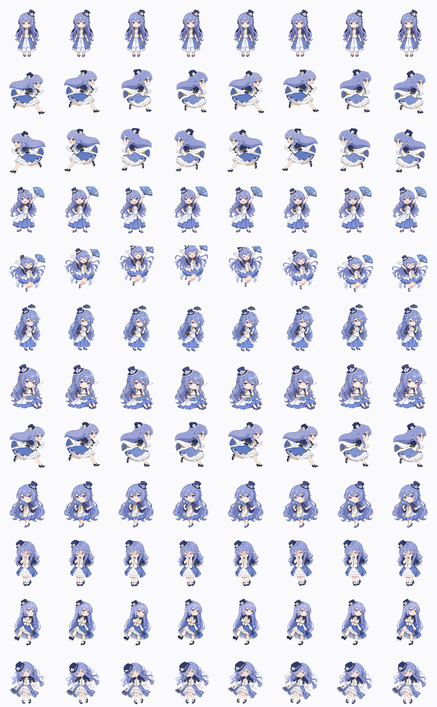

# qwen娘 桌宠

Windows 桌面上的一只养成系桌宠。**纯本地实现，token 消耗恒为 0**——数值、感知、台词全部来自本地状态机和一份手写台词池，不联网、不调模型。



## 怎么跑起来

```powershell
pythonw app/pet.pyw                   # 就她一只：手动起、手动关
pythonw app/sentinel.pyw              # 常驻照看：她挂了拉起来（模式见 bind_qoder）
powershell -File app/install-startup.ps1    # 可选：注册开机自启
powershell -File app/uninstall-startup.ps1  # 撤销自启并结束进程
```

出厂默认是**独立桌宠**：不依赖任何宿主程序，站桌面右下角，`config.local.json` 里
`"requires_qoder": false`、`"follow_qoder": false`。

想让她跟着 Qoder 启停（开发机上就是这么用的），在 `app/config.local.json` 里加：

```json
{ "requires_qoder": true, "bind_qoder": true }
```

`requires_qoder` 管她**自己**（Qoder 消失超过宽限期就自退），`bind_qoder` 管**哨兵**
（Qoder 在才拉起、关过一轮就把"别烦我"作废）。只设前者会出现"她走了但下次没人拉"，
只设后者会出现"她自退了但哨兵又拉起来"，所以这两个要一起给。改完 `bind_qoder` 要重启哨兵，
它只在启动时读一次。

## 生命周期怎么保证

- 哨兵每 3 秒醒一次。命名互斥体保证同时只有一只哨兵
- 她内置看门狗：绑定模式下 Qoder 消失超过宽限期就自毁——**崩溃和任务管理器强杀同样覆盖**
- 存活检测走 Toolhelp32 进程快照。这台机器上 `OpenProcess` 拿到的句柄不可等待
  （`GetExitCodeProcess` 恒失败、`WaitForSingleObject` 对活进程返回"已退出"），不能靠句柄探测
- 坐标全部按 DPI-aware 取。175% 缩放下不声明 DPI 会拿到虚拟化的假坐标
- 她**启动即崩**时哨兵按指数退避重拉（3→6→12…封顶 5 分钟），不会每 3 秒撞一次墙。
  退避按"这一串连续失败"的起点计时，慢启动不会被误判成崩溃
- 她出错时的堆栈进 `run/pet.err.log`（超 256KB 自动清空）。定格这种事没有日志就查不到
- 双击 exe 启动的堆栈进 `app/run/pet.exe.log`，记录解释器、子进程 PID 与启动异常；启动时超过 256KB 轮转为 `.1`。
- 主动退出：绑定模式抑制到 Qoder 关闭或重启，独立模式抑制到守护重启。退出标记没有默认 TTL，避免主动退出后自行回来。

## 养成与"自我意识"

四项数值随真实时间衰减，离线时间也计入（回来会说"你走了 N 小时"）：

| 数值 | 影响 |
| --- | --- |
| 心情 | 低的时候拒绝被摸，动作转成沮丧态 |
| 精力 | 耗尽后倾向打瞌睡，小睡可回 |
| 亲密 | 靠摸头/喂食累积，改变说话口吻 |
| 好奇 | 掉得快，靠互动补 |

`save.json` 里还存着她的自我画像：你最活跃的钟点、最近最常碰的文件名、累计陪伴天数，
每天自动写一篇 `diary/` 日记（统计 + 模板拼装，非生成），周一凌晨结上周的账。

**上限说清楚**：她的"知道"是前台窗口标题 + 空闲时长 + 统计查表，不是理解；台词是有限池子，几天后会开始重复。想升级只需把 `speech.py` 那层换成本地小模型，其余不用动。

## 操控

**她分得清你点在哪里**：按帽子她会护住、戳脸和拉裙摆她会**害羞**（双手捂脸那个新姿势）、
拽头发她会**恼**、拍身子应一声；点在她旁边的空气上不算摸她。

单击摸头 · 双击喂食 · **按住 0.45 秒挠痒** · 拖拽钉住 · **甩出去她会掉在桌面上弹一下再站稳** ·
滚轮改大小（她跟着抻一下）· 右键菜单（跳一下 / 把她放到桌面 / 小睡 / 别说话 / 钉在当前位 / 看看数值 / 写日记 / 退出）

不用点她：她会**跟着你的光标转头**，你走开六秒后自己收回来；光标停在她身上两秒，
她会说一句"你盯着我看做什么"。连点六下她会翻脸——第三下起收益就减半了。

## 参数（`app/config.json`，可被 `config.local.json` 覆盖）

`bind_qoder` 哨兵是否绑 Qoder 启停 · `requires_qoder` 她是否随 Qoder 消失而自退 ·
`follow_qoder` 是否吸附 Qoder 窗口右下角并跟随移动 · `perch_offset` 吸附偏移 ·
`standalone_offset` 独立模式落位（默认贴右下角）· `scale` 大小 · `wander_range` 跑动范围 ·
`speech_min_gap_seconds` / `speech_max_per_hour` 说话节流 · `quiet_hours` 静默时段 ·
`watchdog_grace_seconds` 退出宽限 · `long_work_minutes` 连续工作提醒阈值 ·
`idle_user_seconds` 你多久没动她才算"走开了" · `tts_enabled/tts_voice/tts_rate` 离线语音 ·
`cycle_seconds` 每个状态**一跳多少秒**（播放时长属于动作本身，不属于帧数）

## 动效是怎么来的

不是把几张图平移。`app/rigor.py` 提供三个形变原语，全部动画由它们叠出来：

- `shear_rows(image, offsets)` —— 按行水平位移（亚像素混合）
- `band_scale(image, top, bottom, factor)` —— 按行纵向重采样某个横带
- `polar_twist(image, pivot, amp, r_in, r_out, θ0, θ1)` —— 环形扇区绕枢轴旋转

`polar_twist` 是免遮罩的关节：不需要把图层切开就能让某个方向上的部件独立转（四边羽化）。
另有 `scale_about` 语义的 `squash_stretch`——整幅以指定行为锚作纵向伸缩并配平横向鼓胀，
落地挤压和滚轮抻长时脚不动。

在这三个原语上叠出五层运动：**基础编排**（位移/倾斜/挤压，`qwen_poses.MOTION` 的关键帧按相位插值加密）+ **二级运动**（从运动自身速度取导数，让发梢、裙摆滞后于身体，髋部为支点）+ **关节弹簧**（`rigor.Spring` 跨整条循环预积分三遍再录制，头部反向稳住视线、裙摆滞后回弹；枢轴每帧从形变后的轮廓自动取，所以跟着倾斜走）+ **呼吸**（安静态胸腔纵向 ±1.1%）+ **眨眼**（每个循环里压扁眼带两帧）。安静态的呼吸与眨眼由运行时生命层算，**不烘进帧里**。

关节弹簧的可量化证据（部件位移 vs 身体位移）：

| 状态 | 身体水平位移 | 裙摆 | 头部 |
| --- | --- | --- | --- |
| 挥手 | 0 px | 7 px | 4 px |
| 跳跃 | 0 px | 5 px | 8 px |
| 待机 | 1 px | 4 px | 3 px |
| 右跑 | 8 px | 8 px | 10 px |

弹簧刚度别一味调高：`k=95` 时跑动滞后变好，但待机的摆动从 4px 掉到 1px——跑动的横向甩动本来就由速度驱动的钟摆剪切负责，弹簧只管滞后回弹，软一档（头 k=52/阻尼 7.4，裙 k=34/阻尼 5.2）整体最好。

运行时再加两层。**生命层**（`rigor.LifeLayer`）管安静态：待机/等待/审阅/沮丧这四态不再播帧序列，
而是按墙钟连续算——三个互质周期的重心微摆、3.9 秒一次的呼吸、2.2–7.5 秒随机间隔的眨眼、
6–24 秒一次带包络的主动转头，外加 4–8 分钟一次的东张西望和 6–10 分钟一次的伸懒腰。
预烘帧再密也有周期，24 帧 4 秒的循环一分钟就能被认出来；这一层没有周期可找
（实测：与 4 秒前那一帧的平均差 2.6 灰阶，从不趋零）。

**视线跟随**：读光标相对她头部的水平偏移，量化成 7 档，用 `head_follow_profile` 只剪切头部——
身体不动，头转向你。人离开 6 秒后自动停止跟随。枢轴来自 `rig.json`，存的是**占格子高度的比例**
（曾经存 192 空间的像素行号、运行时却按 291 高的格子用，偏了 1.4 倍）。

| | 数值 |
| --- | --- |
| 帧数 | 232 帧 / 12 状态（9 个常用态 + 3 个反应专用态，每态 16–24 帧） |
| 出帧分辨率 | 384×416（设计格 192×208 的 2 倍） |
| 显示刷新 | **30fps**（`after(33)` + `timeBeginPeriod(1)`，实测 30.1fps；不开高精度定时器只能到 16.2） |
| 形变速率 | 生命层按 20Hz 出图，30fps 的其余 tick 复用同一张画片——形变帧唯一且约 6ms，没必要每 tick 重算 |
| 常驻开销 | 安静态 20Hz × 6.0ms ≈ 12% 单核；跑动/跳跃走预烘帧，几乎不耗 |
| 想要更省 | `config.json` 里 `hi_res_timer: false`（回到 16fps，且不动全系统定时器精度） |

`timeBeginPeriod(1)` 只把系统定时器粒度从 15.6ms 提到 1ms，不联网、不调模型、不额外起刷新循环；
它会影响其它程序的 sleep 粒度，所以这是一个可关的开关，而不是默认行为。

两个行映射原语各有两版：`shear_rows` / `band_scale` 是逐像素精确版，**出帧时**用；
`shear_rows_fast` / `band_scale_fast` 是**分段仿射版**，**运行时**用——按剖面的拐点切段，
每段交给 Pillow 在 C 里做一次仿射重采样。269×291 的格子上，三原语一帧从 22.9ms 降到
6.2ms（占单核约 10%），拐点没切准就会在头发上留下一行接缝，所以 `_band_edges` 里
"拐点 + 至少 3 行一段"这两条是硬要求，不是优化口味。

### 运行时形变四条规矩（踩过坑换来的）

1. **只剪一次**。视线、微摆、主动转头、抛掷侧倾全都是"逐行水平位移"，所以先把剖面相加再剪一次：
   三趟 gather 约 5ms，相加一趟 1.7ms。
2. **脖子以上必须刚**。任何 runtime 侧倾都要带 `rigid_above`，否则头顶拿到最大位移且头内部有梯度，
   礼帽会被拖成一片——烘焙帧里栽过一次，运行时又栽了一次。
3. **幅度不跟 DPI 走**。枢轴和带宽是"行位置"，该随格子放大；幅度是观感参数，
   乘了 1.4 倍 DPI 之后头转得比它所属的姿势还远，这就是"扭曲变严重"的来源。
4. **挤压要配鼓胀**。只压不鼓像橡皮膜；`squash_stretch` 按 0.6 的体积感把身体横向补回来。

跑步原来只有一张图在上下弹，再高的帧率也变不出迈步。现在 `running-right / running-left / running`
用两张步幅帧（`qwen-chibi-run-a/b`：右脚在前 / 左脚在后经过）每 4 帧交替，配合身体起伏。

`running-left` 不是"把带方向的量取反"凑出来的：形参整套沿用 `running-right`，最后把**成品帧整幅翻**。
原因是 `polar_twist` 的扇形羽化只在起始边斜坡，实测振幅取反后仍有 1.6% 的像素不互为镜像。

## 素材管线

```
poses/*.png  →  build_motion.py  →  app/frames/<state>/*.png + app/frames/rig.json
```

`build_motion.py` 复用 `qwen_poses.py` 的去背、色彩拉齐、安全区与姿态编排。改源图后重跑
`python build_motion.py` 就同步全部成品帧；`python build_motion.py shy idle` 只重建这几个态
（顺带保留 `rig.json` 里其余条目）；`python build_motion.py --check` 只量安全框、一个字节都不写。

当前 idle 源图是 `poses/qwen-chibi-idle_20260927_v2.png`：双手自然下垂、扇子放在身侧，
避免旧版待机一直举手造成的招手感（`find_source` 按文件名排序取最后一个）。

两个坑写死在脚本里：

- **安全框**：每格四周留 `SAFE_SIDE/SAFE_TOP/FOOT_MARGIN` 的余量，且缩放的判据是**形变之后**
  的成品剪影而不是入参图——过去只看入参图，于是摆头、关节旋转和眨眼能把人推出格子边，
  跳跃时举起的扇子就是这么被削掉的
- **键色窗口**：`-transparentcolor` 不能混合半透明像素，素材必须先放大再把 alpha 硬阈值到 0/255，
  剪切之后还要再硬阈值一次，否则轮廓外会有一圈键色描边

## 隐私

只读前台窗口标题和本地输入空闲时长，全部在本机判定，不联网、不上传。
本机只写三样：`save.json`（养成数值与使用画像，已在 `.gitignore` 里）、`diary/` 的每日一句、
`run/pet.err.log`（她出错时的堆栈，超过 256KB 自动清空，不然定格这种事查不到原因）。

## 版权

形象基于通义千问非官方吉祥物二创，最先由B站up主生成，仅供个人学习与本地使用；原始参考立绘未纳入本仓库。

## 改动批次与验收闸门

批次台账在 `docs/LEDGER.md`（P 表 Q0-Q5 的 DQ 项、逐行审计的 DA 项、独立化轮次 DB 项、本轮清理的 DC 项）。
当前 14 态、272 帧、332 句。改动后按影响范围运行闸门；最新自动验收见 `docs/validation-20261011/report.json`。

```powershell
python app/selftest.py       # 9 项无头闸门：占位符/触发面/去重/衰减/离线上限/存档/日记/48h 重复率
python tools/probe_audit.py  # 41 项判据：审计轮每个缺陷的复现与修复，含两种生命周期模式
python build_motion.py --check   # 272 帧，安全框与噪点检查
python tools/probe_behavior.py  # 隔离存档与信号：14 态渲染、气泡、冷却、TTL、静音
python tools/probe_launcher.py  # 真实子进程异常、启动失败、日志轮转
python tools/test_exe.py     # exe 冷启动、动画、存活、单实例；暂时停止本项目进程并恢复本地配置
```

几条已经落地的事实，记在这里免得被当成待办：

- **状态过渡**（Q1）：进入任何状态不硬切——0.40s 的"落座"包络（旧姿态单侧淡出 + 正弦形变暗示），
  原 12 态及新增反应态共用过渡机制，最坏过渡步 ≤ 硬切的 65%（`tools/probe_transition.py`）。键控窗口要求 alpha 二值化，
  逐像素双向交叉淡变不可用，所以淡变只能做单侧。
- **信号源**（Q3）：读 `E:\桌宠\signals\` 目录协议。agent 跑任务（`qoder.busy`）、跑完
  （`qoder.done`）、前台白名单（`boss`）都会让她开口。这个目录过去算错一层，她一个信号都没读到
  （DA-6），现在端到端通。与 grok娘 共用同一个目录，谁先读到谁说。
- **防重复**（Q2/R2）：台词 157 → **332** 句；历史窗 12→40；环境类子键 4h 分类级冷却；反应态
  （shy/annoyed/dizzy）台词走独立通道不受 240s 频控。7 天模拟 48h 窗口重复率 0%（selftest H 项）。
- **语音**（Q4）：SAPI5 离线 TTS（Huihui），与 grok娘 同款模块。**当前默认关**（`tts_enabled: false`，
  用户要求静音；气泡文字照常，要出声改回 true）。
